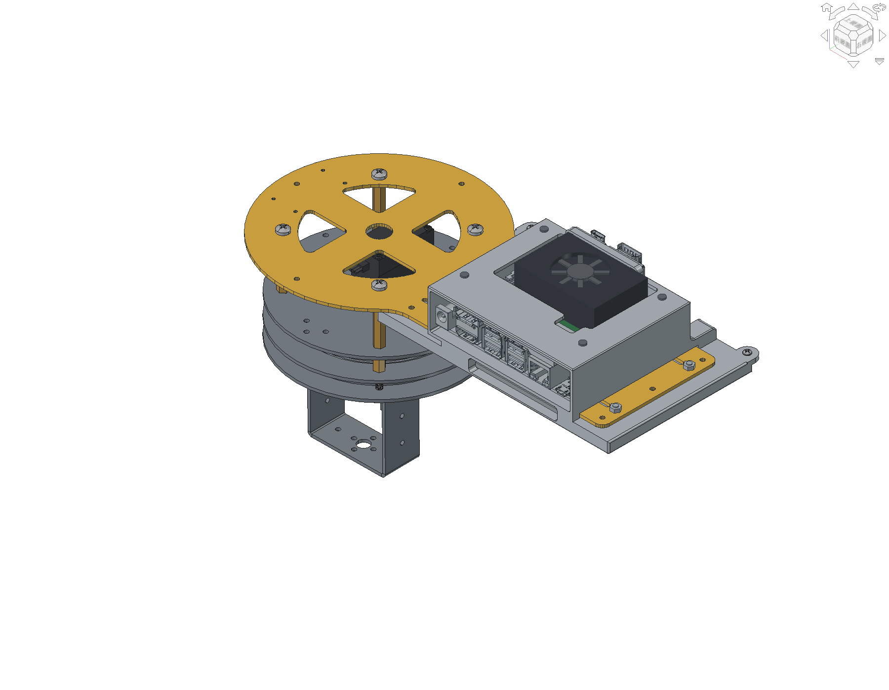
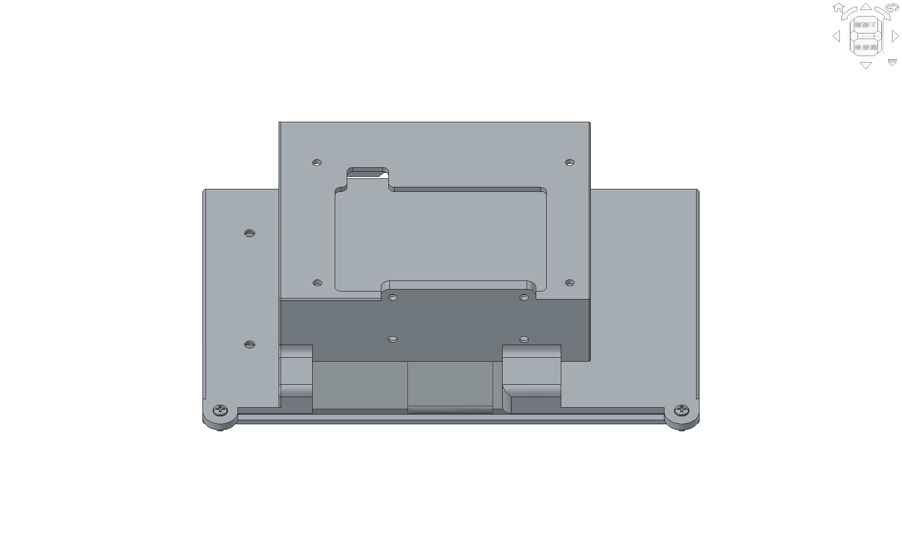
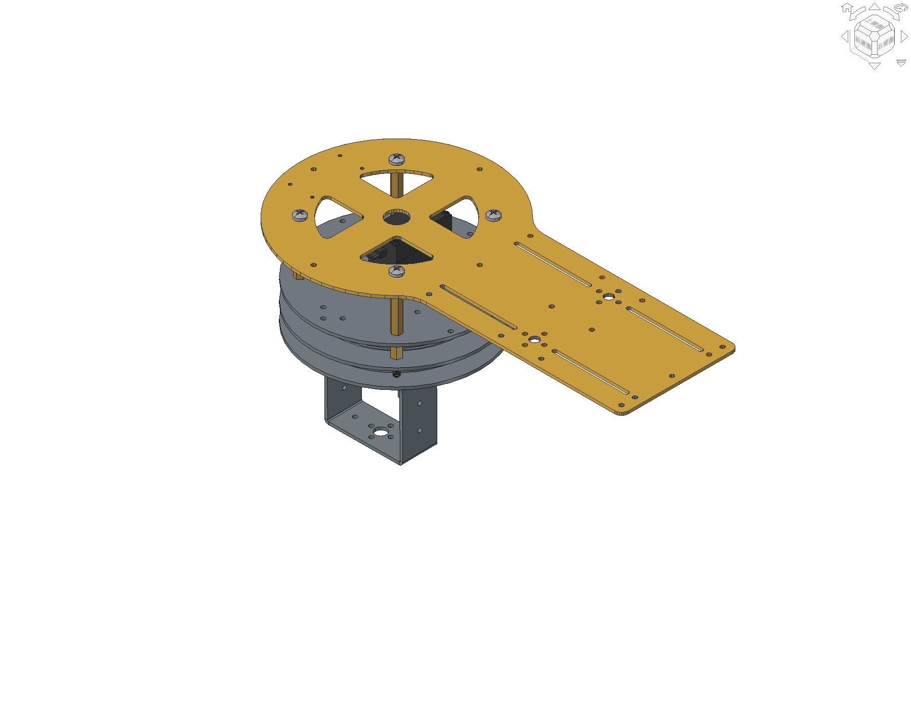

# Shore Jetson Nano Case

Shore Jetson 的 Jetson Nano、Waveshare 70H-1024600 IPS 無觸控顯示器、舵機大底板與雙軸雲台裝配參考。

直接開啟 `Nano_Case_v05_DRAFT.FCStd`，沿用原有的 **「裝配參考 — 不要匯出 STL」** 群組查看組裝；沒有另一份獨立組裝 FCStd。

- `Enclosure`：唯一列印件；顯示開口在草圖內做 R2，入口背面有兩個半圓止擋耳。
- `Reference`：原有 Nano，以及顯示器、轉接板、大底板與名義五金。
- `Hardware/AdapterFasteners`：4 顆 M2.5×6、4 顆螺母、4 片 0.6 mm 墊片，實際規格待核對。
- `Hardware/PlateFasteners`：2 顆 M3×6 與 2 顆 M3 螺母，實際規格待核對。
- `Hardware/DisplayRetentionFasteners`：2 顆名義 M3×8 與 2 顆 M3 螺母，顯示器插入後才安裝。
- `Reference/Gimbal`：來源 STEP 的完整雲台，68 個零件；`GimbalMountFasteners` 為另外補上的 4 顆 M4×10 底板固定螺絲。
- `大底板.DWG`、`大底板.IGS`：原始底板來源，沒有修改。
- [裝配與保存檢查](assembly/verification.json)。

裝配參考不應隨 `Enclosure` 匯出 STL。本次沒有匯出 STL；工作目錄原有的 `nano_case_with_screen.stl` 使用者修改已保留，未納入這次雲台裝配提交。FCStd 以目前開啟版本為準，保留使用者新增的 `Sketch014`／`Pocket007`。

## 官方參數與草圖標註

原有「尺寸表 — 修改 B 欄 (mm)」的 **第 73–80 列** 新增官方參數，附來源連結；原本第 1–69 列保持不變。新增區只記錄官方值，沒有另外建立計算值分區，也不記錄支撐總寬。

| 參數 | 官方值 mm | 用途 |
|---|---:|---|
| `AdapterWidth` / `AdapterHeight` | 50 / 25.5 | 轉接板外框 |
| `AdapterPitchX` / `AdapterPitchY` | 44.7 / 20.2 | 水平／垂直孔中心距，連動草圖 |
| `AdapterBoardHoleDia` | 2.75 | 官方 PCB 孔徑；外殼 M2.5 通孔仍為 Ø3 |
| `DisplayWidth` / `DisplayHeight` | 164 / 97 | IPS 無觸控顯示器外框 |
| `DisplayThickness` | 2.6 | 官方 CAD 主體厚度，不含 FPC 凸出 |

`Sketch008` 直接以兩孔中心距 **44.7 mm** 驅動並完全拘束，連至 `Parameters.AdapterPitchX`；支撐兩側留料在草圖內設定。`Sketch009` 的垂直孔距 **20.2 mm** 連至 `Parameters.AdapterPitchY`。上排孔中心到支撐頂邊改為 **4 mm**。

來源：[Waveshare Wiki](https://www.waveshare.com/wiki/70H-1024600)、[轉接板尺寸圖](https://www.waveshare.com/w/upload/4/48/70H-1024600-FAQ.png)、[官方 IPS CAD](https://files.waveshare.com/upload/7/73/70H-1024600-IPS-CAD.zip)。參考模型擷取 LCD 與 CT 壓克力組裝中的 adapter PCBA，未匯入供應商外殼或觸控玻璃。

## 顯示開口與入口止擋

`Sketch004` 的右邊距 **5.5 → 7 mm**，原本兩個 **2 → 3.5 mm**，高度 **90 → 89 mm**。開口外接尺寸為 **154.5 × 89 mm**。在草圖中保留虛擬角點標註，四角以單一 R2 與等半徑拘束驅動，草圖完全拘束；可調整 `Sketch004.Constraints.OpeningCornerRadius`。

「顯示器圓角」`Fillet` 移除原本開口內側的 **Edge215–218**，其餘圓角保留，避免和草圖 R2 重複。官方 CAD 的有效區為 154.21 × 85.92 mm；縮小後直邊仍露出有效區，R2 在遠離入口的兩角合計遮住約 **0.71 mm²**，依使用者指示接受角落少量遮蔽。

顯示器由 **+Y 端（Y=102 mm）** 沿導槽向內插入。兩耳位於顯示器背面，Z=-6～-3 mm，各寬 12 mm、厚 3 mm、伸出原殼邊 8 mm，外端為 **R6 半圓**，以短頸接到原殼邊。`DisplayEarSketch.Constraints.EarRadius` 驅動兩個半圓，`DisplayEarPad` 設定厚度。`DisplayEarHoleSketch`／`DisplayEarHolePocket` 為 **Ø3.4 mm** 通孔，軸向為 Z，垂直顯示面；兩孔 X、Y 位置仍為 `(-34,104)` 與 `(123,104) mm`。

裝屏後，由**顯示器背面**沿 -Z 穿入兩顆 **M3×8**，以 **對邊 5.5、厚 2.4 mm** 螺母鎖住耳朵。螺母仍在原顯示器插口內，Z=-8.4～-6 mm；相較前版往背面調整 0.6 mm，讓螺母貼合耳底。螺絲座面 Z=-3 mm、尖端 Z=-11 mm。螺母需由入口側扶持；這是邊緣止擋，不靠螺絲壓玻璃。模型中螺母距離 LCD 邊緣仍為 **1.75 mm**，螢幕外移 2 mm 時會被兩個螺母擋住；拆屏前要先取下兩組五金。實際螺絲頭型、螺母與工具空間仍須試裝核對。

## 轉接板高度與孔位

修改前支撐頂面 Z=35.90 mm，風扇外框頂面 Z=34.88 mm，模型高差為 **1.02 mm**。依風扇外框頂面降低轉接板，使其官方 CAD 的最高點與風扇同為 Z=34.88 mm；轉接板與五金一同下移約 **1.1242 mm**。

上排孔 Z 約 **30.8758 mm**，下排孔約 **10.6758 mm**；水平／垂直孔距保持 44.7 × 20.2 mm。下排螺母槽深 1 mm、保留 1 mm 承壓壁；上排螺母槽深 2 mm。

孔位與螺母槽改為直接參照草圖孔中心，避免降低支撐後原實體面的編號變動造成連動失效。降低後上排孔局部進入原頂板範圍，新增 `AdapterUpperHoleSketch`／`AdapterUpperHolePocket`，以原孔位為參照補做 Ø3、深 4 mm 的貫穿孔，避免頂板擋住螺絲。

## 大底板方向與插入位置

圓形端**靠近 DC 電源孔**。目前繞 Z 軸 +90°，位置 `(-86,45,-3) mm`；底板端部兩個圓孔對準外殼 `(113,18.2)` 與 `(113,71.8) mm` 的固定孔。

要改插入位置：選取 `Reference` 中的 **舵機大底板**，調整「資料 → Placement → Position → x」。目前 X=-86 mm；改為 -76 mm 就會再向殼內推入 10 mm。本次保留目前插入位置。插槽為貫通槽，模型沒有端止擋；改位置後需重新核對底板孔／長孔對位，以及雲台支柱、固定螺絲與外殼的間隙。

## 雲台與大底板

使用 [Drive 資料夾](https://drive.google.com/drive/folders/1EO_m7Y_lFSU7mPn-MkYwMT3yQha6iysP) 中的「大圆形云台.STEP」，保留來源模型的 68 個實體及原有關節姿態。沒有重複放入單軸版本，也沒有另加一片大底板。來源 STEP 存於本機備份區，依原設定不加入 Git；幾何已內嵌在原 FCStd 的 `Reference/Gimbal`。

雲台在大底板下方，四根 M4×35 支柱的頂面接到原底板下表面 Z=-3 mm。支柱孔距 **70 × 70 mm**，對應現有約 **70.0036 × 70.0036 mm** 的四個 Ø4 孔；剛體定位後各孔中心殘差約 **0.00253 mm**。來源座標另有約 0.32549° 的平面偏角，已在裝配定位中校正，沒有修改零件形狀。

補上四顆名義 **M4×10**，由底板上表面 Z=-1 mm 鎖入支柱，穿過 2 mm 底板後名義鎖入 8 mm。螺絲幾何取自同資料夾的單軸 STEP。現有 Ø4 孔搭配 M4 為名義零孔徑餘量，實物孔徑與螺紋配合仍須試裝核對。

`Gimbal.Placement` 以 `MountPlate.Placement * MountOffset` 連動原大底板；沿用 `BasePlate.Placement.Position.x` 調整插入位置時，雲台與四顆固定螺絲會一起移動。`MountOffset` 保存來源模型相對底板的定位。檢查只涵蓋目前靜態姿態，未驗證雲台轉動行程、線材、負載或實體運動。

## 組裝與驗證界線

外殼內順序為轉接板 → Nano → 大底板 → 顯示器 → 兩組入口止擋五金。雲台與大底板先以四顆 M4×10 接合，再依實際操作空間插入底板。Nano 原有上、下螺絲各四顆，底板及顯示器裝入前先鎖好；底板兩顆螺絲也須在顯示器滑入前鎖好。顯示器滑入時先移除兩組止擋螺絲及螺母，先接好 FPC 並確認不會夾線，插入後再鎖止擋。

**底板垂直名義餘量仍為 0 mm：** 3 mm 槽內容納 2 mm 底板與模型中 1 mm 的 Nano 底部螺絲頭。靜態無體積交集不能證明實物能順利滑入；仍須核對螺絲頭高與列印公差。本次沒有變更槽高或 Nano 底孔。

本次驗證目前開啟模型的草圖與既有幾何保存、雲台孔位、接合面、雲台／固定螺絲與既有裝配的交集，以及存檔重開。另在測試副本驗證底板 X 改變 10 mm 時，雲台一同平移 10 mm，再還原位置。原有 LCD 滑入及入口止擋檢查見前版紀錄；本次未重做雲台行程、大底板完整滑入路徑、FPC 彎折／HDMI／USB 線材、工具手柄、列印強度或實物裝配驗證。

## 保存與版本

- `5def314`：Drive 原版，排除 FCBak 與 STEP。
- `a1d5e46`：完整保留當時本機狀態；原 FCStd SHA-256 為 `958c75cda8235a8606d0e8c6ded55bea8f2996a24d02a64355517ed111d412b6`。
- `0c6ca15`：初版獨立組裝參考；後續移除獨立檔，歷史仍可取回。
- `667ebc6`：轉接板特徵、官方模型、五金與動畫的上一版。
- `28ca475`：底板圓形端靠近電源孔、官方參數入表、直接標註 44.7 mm、降低轉接板與支撐、頂邊距改 4 mm。
- `98c9b90`：縮小 Sketch004 開口、將內側 R2 移入草圖，加入可拆 M3 止擋雙耳與五金。
- `fb23d0a`：雙耳移到顯示器背面並改成 R6 半圓，M3×8 由背面穿入，螺母保留在插口內。
- 本版：保留目前開啟模型，加入完整雲台、四顆 M4×10 與底板位置連動，沿用原 FCStd。

本次不製作動畫。[先前動畫](assembly/assembly_sequence.mp4) 僅保留作為 `667ebc6` 的歷史資料，方向與高度已不適用目前版本。

FCBak、自動備份與 STEP 不納入 Git；FCStd 視為二進位檔案，避免文字合併。準備列印前先處理已知裝配問題，再從確認過的 `Enclosure` 匯出 STL。
